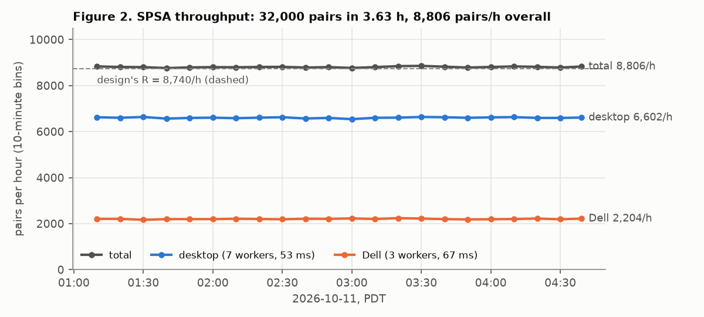
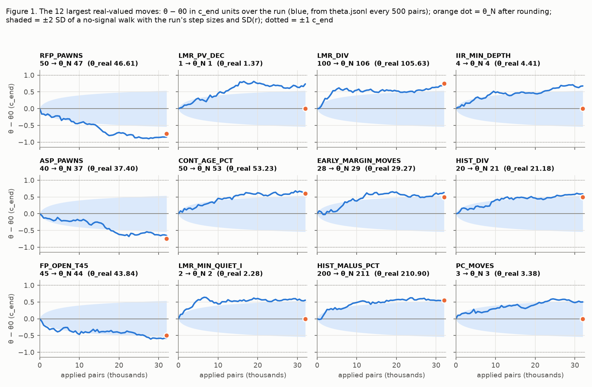
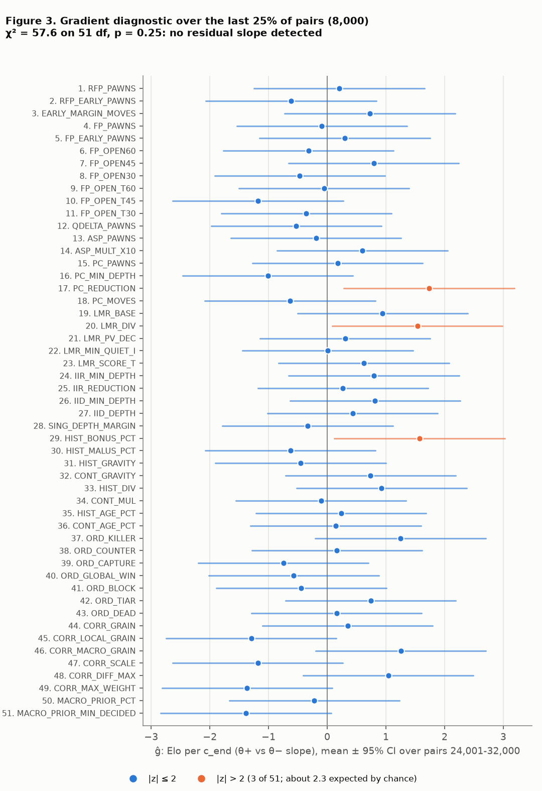
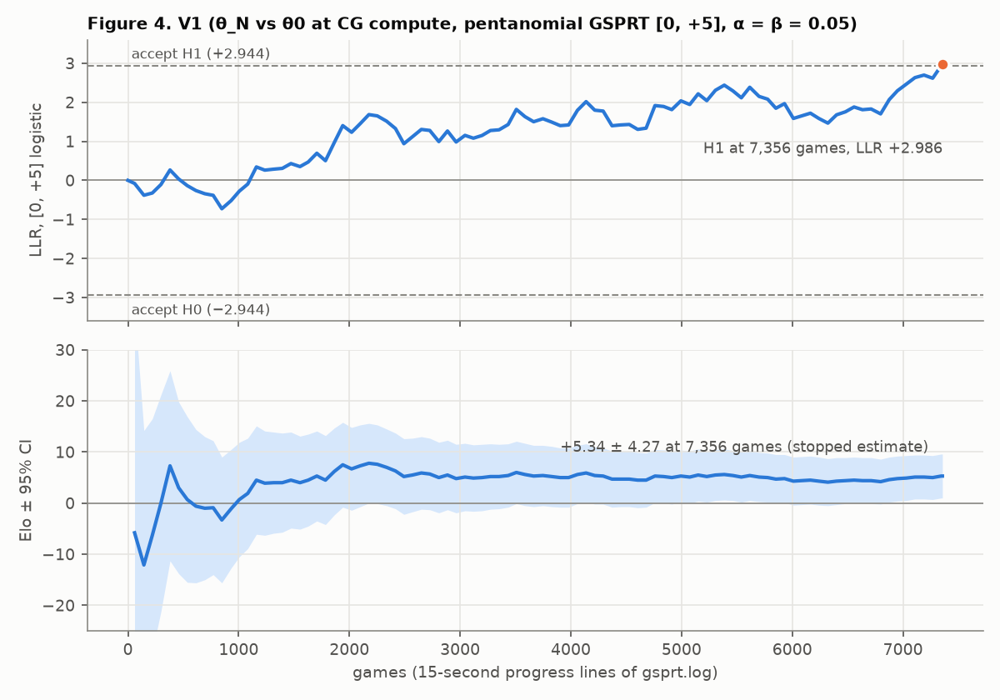

# Search SPSA on W1 at CodinGame compute: report

> **About this report.** It was written for the repository on 2026-10-11 from the study's records. Those records live in the local experiment archive `datasets/nnue2/search_tune/w1/`, which is git-ignored and not part of this repository. They include the pre-registered design `DESIGN.md` v3.1, the SPSA's pair records, the chain's summary, V1's game records, the builds and the scripts behind every number here. Paths in the body are relative to that directory. The figures in [`fig/`](fig/) were drawn with matplotlib by `report/make_figs.py` from `spsa/run/theta.jsonl`, `spsa/run/pairs.jsonl` and `gsprt/stw1_v1/gsprt.log`. "±" is a 95% half-width. The shipped change is in `cpp_impl/codingame_nnue.cpp`.

**Status (2026-10-11, PDT): final.** The SPSA ran from 01:04:52 to 04:43:06 and the verification test V1 from 04:44:05
to 05:08:26; the chain wrote its decision at 05:09:04. Everything below was computed from the run's own records.

## Summary

- **Question.** The shipped search (main 219f0f8) has 51 tunable constants. Most were set by hand or in the HCE era,
  and none had been tested on the current net W1 (`r16_x128_l2400_s1601_rs`). Is there Elo left in them on W1 at
  CodinGame compute (CGC)?
- **Method.** One SPSA tuned all 51 together at CGC (desktop 7 workers at 53 ms, Dell 3 workers at 67 ms) over 32,000
  game pairs of θ+ against θ−, starting from θ0, the shipped values. The rounded result θ_N then got exactly one
  pre-registered confirmatory test, V1: θ_N against θ0, both as constexpr builds, at CGC, as a pentanomial GSPRT
  with logistic bounds [0, +5], α = β = 0.05 and an 80,000-game cap counted as H0. V1 played cfbook lines that the
  SPSA never started from.
- **Answer: yes.** V1 accepted H1 after 7,356 games (3,678 pairs, 24 minutes) with LLR +2.986. Pentanomial
  [73, 719, 1977, 840, 69] (LL..WW); W/D/L 1,364 / 4,741 / 1,251.
- **Elo: +5.34 ± 4.27 (95% [+1.07, +9.61]); nElo +9.93 ± 7.94; LOS 99.3%.** These numbers are read at the GSPRT's
  stopping point, so they are **a stopped estimate, biased upward**. In simulation, a [0, +5] test that accepts H1
  overstates the truth by about +2 Elo on average when the truth is +4 or more, and by more when the truth is smaller
  (section 4.2). Read the result as "θ_N is better than θ0, probably by a few Elo", not as a measured +5.3.
- **The gain is diffuse.** 28 of the 51 constants changed after rounding, and none moved as far as 1 c_end, the
  SPSA's final perturbation size. The largest move was RFP_PAWNS 50 → 47 (−0.75 c_end; −0.85 before rounding).
  What V1 tested is the vector, not any single value.
- **Secondary (reported only, not evidence either way).** θ_N searches a tree 14.9% larger at bench depth 12
  (33,556,236 nodes against 29,208,628), at an nps ratio of 0.987. LMR_DIV 100 → 106 alone accounts for +15.0%.
- **What ships.** Under the owner's standard, a change that passes a GSPRT [0, +5] is a gainer, so θ_N ships. That
  means a PR on main whose diff is θ_N's constant edits, all on anchor lines of `cpp_impl/codingame_nnue.cpp` (31
  lines in the build's diffcheck; the build is `stw1_thetaN_98670b7f`). The lead also makes two CodinGame
  submissions. θ_N is a W1 result, so a later net needs its own check.

## 1. Design in brief

| Item | Value |
| --- | --- |
| Engine | The runtime-C worktree b40b49e9: main 219f0f8's search plus a fast table bake and a raw-byte payload, which are not shipped and give byte-identical tables. W1's net header is 50a3ff4c. The θ0 bench is `c12bfc8e73c521ca`, 29,208,628 nodes |
| Parameters | 51 (DESIGN §3): pruning margins and tiers (#1-12), aspiration (#13-14), ProbCut (#15-18), LMR (#19-23), IIR and IID (#24-27), the pseudo-singular margin (#28), history and move ordering (#29-43), and the correction histories with the macro prior (#44-51). Boxes, c_end and θ0 are in Table 2. Constraint C1 is IID_DEPTH ≤ IID_MIN_DEPTH − 1; C2 is CORR_DIFF_MAX × CORR_MAX_WEIGHT ≤ CORR_SCALE |
| Tuning engine | Parameters come in through the `CF_TUNE` environment variable, with one engine restart per pair and a TUNEHASH check at every start. Divisions are exact fast divisions. Fifteen identity gates (G1-G15) came first: the bench identity at θ0, env builds equal to constexpr builds, no state carried across games, and speed within 1% |
| SPSA | The fishtest schedule: A = 0.1·N = 3,200, α 0.602, γ 0.101, r_end 0.00125. The perturbation c_k = c_end·(N/k)^γ runs from 2.85 c_end at k = 1 down to 1 c_end at k = N. Δ ∈ {±1}^51 comes from a seeded rng. Seat values use stochastic rounding with one shared uniform per pair. θ is clipped to the box, and up to 20 pairs are in flight at once |
| N | Set by the start-time rule: N = min(40,000, 1,000·⌊0.95 · 8,740/h · (hours from T0 to 05:00) / 1,000⌋). T0 was 01:04:52, which gave **N = 32,000** |
| θ_N | θ after all 32,000 results, rounded half to even, then C1 and C2 (neither fired) |
| V1 | θ_N against θ0, constexpr builds from one builder, the CGC layout, GSPRT logistic **[0, +5]**, α = β = 0.05, pentanomial, cap 80,000 games = H0. Openings: the `stw1_v1` cfbook permutation, blocks desktop 34,400 + Dell 11,700. The bounds were changed from the design's [0, +2] by the owner at 00:59, before any game (section 7) |
| Decision rules | D3: V1 accepts H1 → recommend shipping. D4: V1 fails → θ0 stays and θ_N is closed. D5: no decision → θ0 stays. Exactly one confirmatory test |

## 2. The SPSA run

**Table 1.** Health of the SPSA run. Sources: `spsa/run/pairs.jsonl`, `spsa.log`, `state.json` and `schedule.json`.

| Item | Value |
| --- | --- |
| Timing | T0 01:04:52; first result 01:05:01, last 04:43:03; exit 0 ("finished") at 04:43:06 |
| Pairs | 32,000 dispatched, 32,000 results, 32,000 applied, 0 lost. Replaying `pairs.jsonl` reproduces the live θ exactly, and `theta.jsonl` agrees with the replay to within 5e-6 |
| Per host | Desktop 23,992 pairs (75.0%) at 6,602/h; Dell 8,008 (25.0%) at 2,204/h |
| Rate | **8,806 pairs/h** overall over 3.63 h. The design assumed R = 8,740/h; the real-engine smoke ran at 8,941/h. The rate stayed within ±1% in every 10-minute bin (Figure 2) |
| Games | 64,000. Draw rate 63.1%; 55.0 plies per game. Pentanomial of θ+ against θ−: [681, 6,882, 16,666, 7,079, 692]. SD(r) 0.780 (power.md assumed 0.783) |
| Forfeits, crashes, illegal moves | 0, 0, 0 |
| Late replies (slower than ms + 30) | **2**, both on the desktop's worker 0 (CPU 2): pair 1,156 (93.0 ms, the θ− seat) and pair 18,755 (103.4 ms, the θ+ seat). Both were far under the 1,000 ms forfeit, and both pairs were applied, as the design specifies (late replies are counted, not treated as bad). The Dell's slowest reply was 82.6 ms, under its 97 ms limit |
| Harness | 0 harness errors. 64,000 engine starts and 64,000 TUNEHASH checks, none late and none wrong. 0 worker pauses, 0 dropped hosts, 1 Dell session (no reconnect), 0 coordinator restarts |
| Hygiene | 21 ten-minute lines: desktop busy 7.1-7.9 logical CPUs (7 workers plus the coordinator), Dell 3.10-3.17 cores, no P2-book process on either host. `spsa.log` has no WARNING line |
| Speed gate G6 | The tuning engine against the constexpr build: desktop 1.004-1.008 and Dell 1.000-1.007 over all measurements (the final window gave 1.0019 and 1.0067), so T3's 53 and 67 ms were used |
| Projections and clamps | C1 fired on 6,104 of the 64,000 seat vectors (1,019 of 16,000 in the last 25%), C2 on 4; θ_N needed neither. In the last 25%, IID_DEPTH was the only parameter with clamped seat values (100% of pairs, since θ0 = min). The small integers' early clamps, while c_k was up to 2.85 c_end, affected at most 0.6% of pairs |
| Couplings (DESIGN §10) | The S19 switch (SING_DEPTH_MARGIN ≥ PC_REDUCTION − 1) was on in 72.4% of seat vectors (72.2% in the last 25%), and it is on at both θ0 and θ_N. MACRO_CLIP bound in 1.3% of seat vectors, and in none in the last 25% |



## 3. Where θ went

**Table 2.** All 51 parameters.
- θ_N is θ at k = N after rounding; bold marks a value that differs from θ0. θ_real is the real-valued θ at k = N.
- θ̄ is the mean of θ over k ∈ (28,800, 32,000], rounded. It is reported only and was never built.
- Moves are in c_end units.
- ĝ is the gradient diagnostic of section 3.2, in Elo per c_end; its SE is 0.74 for every parameter.
- "At bound" follows DESIGN §3: within 1 c_end of a bound, or the seat value clamped in more than 10% of the last 25%
  of pairs.

| # | Parameter | θ0 | Box | c_end | θ_N | θ_real | θ̄ | Move θ_N | Move θ_real | ĝ (Elo/c_end) | Notes |
| ---: | --- | ---: | --- | ---: | ---: | ---: | ---: | ---: | ---: | ---: | --- |
| 1 | RFP_PAWNS | 50 | [25, 90] | 4 | **47** | 46.6 | 47 | -0.75 | -0.85 | +0.21 |  |
| 2 | RFP_EARLY_PAWNS | 25 | [10, 50] | 2.5 | **24** | 24.4 | 25 | -0.40 | -0.22 | -0.62 |  |
| 3 | EARLY_MARGIN_MOVES | 28 | [16, 40] | 2 | **29** | 29.3 | 29 | +0.50 | +0.63 | +0.73 |  |
| 4 | FP_PAWNS | 80 | [40, 140] | 6 | 80 | 79.9 | 80 | +0.00 | -0.01 | -0.09 |  |
| 5 | FP_EARLY_PAWNS | 20 | [8, 40] | 2 | 20 | 20.0 | 20 | +0.00 | -0.02 | +0.30 |  |
| 6 | FP_OPEN60 | 15 | [5, 30] | 1.5 | 15 | 14.7 | 15 | +0.00 | -0.22 | -0.32 |  |
| 7 | FP_OPEN45 | 20 | [8, 40] | 2 | **19** | 19.2 | 19 | -0.50 | -0.42 | +0.79 | = FP_EARLY_PAWNS at θ0, a kink (DESIGN §10b) |
| 8 | FP_OPEN30 | 50 | [20, 80] | 4 | **51** | 50.9 | 51 | +0.25 | +0.22 | -0.47 |  |
| 9 | FP_OPEN_T60 | 60 | [52, 70] | 2 | 60 | 60.2 | 60 | +0.00 | +0.12 | -0.06 |  |
| 10 | FP_OPEN_T45 | 45 | [36, 56] | 2 | **44** | 43.8 | 44 | -0.50 | -0.58 | -1.18 |  |
| 11 | FP_OPEN_T30 | 30 | [20, 42] | 2 | 30 | 29.7 | 30 | +0.00 | -0.15 | -0.36 |  |
| 12 | QDELTA_PAWNS | 350 | [150, 700] | 30 | **344** | 344.4 | 345 | -0.20 | -0.19 | -0.53 |  |
| 13 | ASP_PAWNS | 40 | [15, 80] | 4 | **37** | 37.4 | 37 | -0.75 | -0.65 | -0.19 |  |
| 14 | ASP_MULT_X10 | 30 | [15, 60] | 3 | **29** | 29.0 | 29 | -0.33 | -0.33 | +0.60 |  |
| 15 | PC_PAWNS | 60 | [25, 110] | 6 | 60 | 59.9 | 60 | +0.00 | -0.01 | +0.18 |  |
| 16 | PC_MIN_DEPTH | 5 | [3, 9] | 0.75 | 5 | 4.89 | 5 | +0.00 | -0.15 | -1.01 | with #17 (DESIGN §10c) |
| 17 | PC_REDUCTION | 4 | [2, 6] | 0.6 | 4 | 3.90 | 4 | +0.00 | -0.17 | +1.73 | gradient z = +2.3; S19 switch with #28 (DESIGN §10a) |
| 18 | PC_MOVES | 3 | [1, 8] | 0.75 | 3 | 3.38 | 3 | +0.00 | +0.50 | -0.63 | real move rounds back to θ0 |
| 19 | LMR_BASE | 55 | [-30, 140] | 10 | **52** | 51.9 | 52 | -0.30 | -0.31 | +0.94 |  |
| 20 | LMR_DIV | 100 | [60, 170] | 8 | **106** | 105.6 | 105 | +0.75 | +0.70 | +1.54 | gradient z = +2.1 |
| 21 | LMR_PV_DEC | 1 | [0, 2] | 0.5 | 1 | 1.37 | 1 | +0.00 | +0.74 | +0.30 | real move rounds back to θ0 |
| 22 | LMR_MIN_QUIET_I | 2 | [1, 4] | 0.5 | 2 | 2.28 | 2 | +0.00 | +0.56 | +0.01 | real move rounds back to θ0 |
| 23 | LMR_SCORE_T | 0 | [-100, 100] | 12 | **1** | 1.4 | 2 | +0.08 | +0.11 | +0.62 |  |
| 24 | IIR_MIN_DEPTH | 4 | [2, 8] | 0.6 | 4 | 4.41 | 4 | +0.00 | +0.68 | +0.80 | real move rounds back to θ0 |
| 25 | IIR_REDUCTION | 1 | [0, 2] | 0.5 | 1 | 0.81 | 1 | +0.00 | -0.39 | +0.27 | real move rounds back to θ0 |
| 26 | IID_MIN_DEPTH | 3 | [2, 6] | 0.6 | 3 | 3.28 | 3 | +0.00 | +0.47 | +0.81 | real move rounds back to θ0 |
| 27 | IID_DEPTH | 1 | [1, 3] | 0.5 | 1 | 1.16 | 1 | +0.00 | +0.33 | +0.43 | **at bound**: within 1 c_end of a bound; seat clamped in 100% of the last 25%; real move rounds back to θ0; θ0 = min (one-sided) |
| 28 | SING_DEPTH_MARGIN | 3 | [1, 6] | 0.6 | 3 | 2.99 | 3 | +0.00 | -0.02 | -0.33 | S19 switch with #17 (DESIGN §10a) |
| 29 | HIST_BONUS_PCT | 100 | [50, 200] | 10 | **104** | 103.7 | 104 | +0.40 | +0.37 | +1.57 | gradient z = +2.1 |
| 30 | HIST_MALUS_PCT | 200 | [100, 320] | 20 | **211** | 210.9 | 211 | +0.55 | +0.55 | -0.63 |  |
| 31 | HIST_GRAVITY | 10,000 | [5,000, 20,000] | 1000 | **9,570** | 9,570 | 9,556 | -0.43 | -0.43 | -0.45 |  |
| 32 | CONT_GRAVITY | 10,000 | [5,000, 20,000] | 1000 | **10,278** | 10,278 | 10,246 | +0.28 | +0.28 | +0.74 |  |
| 33 | HIST_DIV | 20 | [10, 40] | 2 | **21** | 21.2 | 21 | +0.50 | +0.59 | +0.93 |  |
| 34 | CONT_MUL | 3,277 | [1,600, 6,500] | 300 | **3,284** | 3,284 | 3,295 | +0.02 | +0.02 | -0.10 |  |
| 35 | HIST_AGE_PCT | 50 | [20, 85] | 5 | 50 | 49.8 | 50 | +0.00 | -0.03 | +0.24 |  |
| 36 | CONT_AGE_PCT | 50 | [20, 85] | 5 | **53** | 53.2 | 53 | +0.60 | +0.65 | +0.14 |  |
| 37 | ORD_KILLER | 25 | [5, 60] | 3 | **26** | 26.5 | 27 | +0.33 | +0.50 | +1.25 |  |
| 38 | ORD_COUNTER | 40 | [10, 90] | 4 | **39** | 39.3 | 39 | -0.25 | -0.18 | +0.17 |  |
| 39 | ORD_CAPTURE | 100 | [40, 200] | 10 | 100 | 99.6 | 99 | +0.00 | -0.04 | -0.75 |  |
| 40 | ORD_GLOBAL_WIN | 800 | [300, 1,500] | 80 | **812** | 811.5 | 815 | +0.15 | +0.14 | -0.57 |  |
| 41 | ORD_BLOCK | 75 | [25, 150] | 7 | 75 | 74.9 | 75 | +0.00 | -0.01 | -0.44 |  |
| 42 | ORD_TIAR | 50 | [15, 100] | 5 | **49** | 49.3 | 49 | -0.20 | -0.14 | +0.74 |  |
| 43 | ORD_DEAD | 250 | [80, 500] | 25 | **254** | 253.6 | 253 | +0.16 | +0.14 | +0.16 |  |
| 44 | CORR_GRAIN | 24 | [12, 48] | 2 | 24 | 23.8 | 24 | +0.00 | -0.11 | +0.35 |  |
| 45 | CORR_LOCAL_GRAIN | 48 | [24, 96] | 4 | **47** | 46.5 | 47 | -0.25 | -0.36 | -1.29 |  |
| 46 | CORR_MACRO_GRAIN | 12 | [6, 24] | 1 | 12 | 12.4 | 12 | +0.00 | +0.38 | +1.25 | real move rounds back to θ0 |
| 47 | CORR_SCALE | 16,384 | [8,192, 32,000] | 1500 | **15,678** | 15,678 | 15,694 | -0.47 | -0.47 | -1.18 | sets all three correction caps (DESIGN §10) |
| 48 | CORR_DIFF_MAX | 1,024 | [400, 2,048] | 100 | **1,056** | 1,056 | 1,053 | +0.32 | +0.32 | +1.04 |  |
| 49 | CORR_MAX_WEIGHT | 8 | [3, 16] | 1 | 8 | 8.0 | 8 | +0.00 | -0.02 | -1.37 |  |
| 50 | MACRO_PRIOR_PCT | 100 | [30, 170] | 10 | **98** | 98.5 | 98 | -0.20 | -0.15 | -0.22 |  |
| 51 | MACRO_PRIOR_MIN_DECIDED | 3 | [1, 6] | 0.6 | 3 | 2.73 | 3 | +0.00 | -0.45 | -1.39 | real move rounds back to θ0 |

### 3.1 Movement

- **Changed after rounding:** 28 of 51. **Moved ≥ 1 c_end:** none, in θ_N or in θ_real. The largest moves are
  RFP_PAWNS (−0.75 c_end in θ_N, −0.85 in θ_real), then LMR_DIV and ASP_PAWNS (θ_N ±0.75). **At bound:** only
  IID_DEPTH, which was expected because θ0 is its minimum.
- **More movement than noise would give** (post hoc, descriptive). A no-signal walk with this run's step sizes and its
  SD(r) of 0.780 ends with an SD of 0.269 c_end per parameter. Eleven of the 51 real-valued moves lie beyond 2 SD,
  where 2.3 are expected by chance, and Σz² = 106.4 on 51 df (p ≈ 9 × 10⁻⁶). The walk model ignores bounds,
  rounding and staleness, all of which are small here. The excess means that for much of the run the SPSA followed a
  real slope, which agrees with V1.
- **Trajectories (Figure 1).** Most moves built up over the first 15,000-20,000 pairs and then flattened. θ̄
  differs from θ_N in 13 parameters, by at most 0.4 c_end (RFP_EARLY_PAWNS: 25 against 24).
- **Rounding.** Nine parameters (small integers, plus CORR_MACRO_GRAIN) moved 0.33-0.74 c_end in θ_real but round
  back to θ0. They are marked in Table 2: LMR_PV_DEC 1.37, IIR_MIN_DEPTH 4.41, LMR_MIN_QUIET_I 2.28, PC_MOVES 3.38,
  IID_MIN_DEPTH 3.28, MACRO_PRIOR_MIN_DECIDED 2.73, IIR_REDUCTION 0.81, CORR_MACRO_GRAIN 12.38 and IID_DEPTH 1.16.
  **V1 tested none of these moves.**



### 3.2 Gradient diagnostic

**Definition.** Over the last 25% of applied pairs (k = 24,001-32,000; 8,000 pairs), ĝ_i = mean(r_k·Δ_k,i / (2·c_k,i)),
with SE = sd/√n. Here r is θ+'s wins minus its losses over the pair, Δ is recomputed from the driver's seed exactly as
`spsa_math.Schedule.delta` draws it, and c_k comes from `Schedule.ck`. The result is converted to Elo per c_end as
ĝ_i·c_end,i / 0.005756, since 1 Elo moves E[r] by 4·ln10/1600. It estimates how much Elo a 1-c_end move of parameter
i is worth near the end-of-run θ. With |Δ| = 1 the SE is the same for every parameter: 0.74, so ±1.45 at 95%.

**Result (Figure 3).**
- 3 of 51 parameters have |z| > 2, where 2.3 are expected by chance:
  - PC_REDUCTION +1.73 (z = 2.34);
  - HIST_BONUS_PCT +1.57 (2.13);
  - LMR_DIV +1.54 (2.07).
- Over all 51, χ² = 57.6 on 51 df, p = 0.25.
- So at the end, θ sat where 8,000 pairs detect no slope. As DESIGN §9 requires, these numbers are noted and not
  acted on.
- The positive slopes of LMR_DIV and HIST_BONUS_PCT point the same way as their moves. PC_REDUCTION's slope points
  against its small real-valued move.



## 4. V1: θ_N against θ0

### 4.1 Result

**Table 3.** V1 `stw1_v1`. Sources: `gsprt/stw1_v1/summary.json`, `gsprt.log` and `chain/summary.json`.

| Item | Value |
| --- | --- |
| Engines | Candidate `stw1_thetaN_98670b7f` (ELF 344fe021…, exe 7ce26d31…); reference `stw1_theta0` (ELF 4f257b01…, exe 13573787…). Both are built from runtime b40b49e9 by the same builder. θ_N's build passed det (identical on both hosts: bench `2a98b40db0e87d7e`, 33,556,236 nodes), bakechk (7,099,520 values), diffcheck (31 changed lines, 0 off the anchor lines) and tunecheck (env = constexpr on both hosts) |
| Timing | Driver 04:44:05-05:08:26 (24.4 min); games 04:44:26-05:07:53; 313 games/min |
| Verdict | **PASS (H1)**: the LLR reached the upper bound at pair 3,678 (7,356 games), LLR +2.986 against bounds ±2.944 |
| Pentanomial (LL..WW) | [73, 719, 1977, 840, 69]; pair SD 0.190 |
| W / D / L | 1,364 / 4,741 / 1,251; score 0.50768; draws 64.5%; 55.1 plies per game |
| Elo (**stopped estimate, biased upward**) | **+5.34 ± 4.27** (95% [+1.07, +9.61]); nElo **+9.93 ± 7.94**; LOS 99.3% |
| Overshoot | 114 games finished after the decision and are not used. With them: +5.49 ± 4.23 over 7,470 games |
| Per host (reported, not judged) | Desktop (clang, 53 ms) +3.07 ± 4.87 over 5,538 games; Dell (g++ with CodinGame's command line, 67 ms) +12.24 ± 8.84 over 1,818 games. The difference, +9.2 ± 10.1 (z = 1.78), is within noise. Pair shares 0.7526 and 0.2474 |
| Hygiene | 0 forfeits or crashes, 0 illegal moves, 0 late replies in 357,243 moves, 0 harness errors, 0 restarts. Maximum reply: desktop 56.0 / 53.2 ms (candidate / reference), Dell 79.7 / 81.1 ms (late limits 83 and 97). No leftover process and no P2-book process on either host |



### 4.2 The stopped estimate

A GSPRT stops when the LLR first crosses a bound, so the Elo read at an H1 stop is selected to be high. To see how
large that bias is for this test, `report/stop_bias_sim.py` ran a simulation:
- 4,000 runs for each true Elo from −1 to +8 in steps of 0.5;
- pairs drawn from V1's own pentanomial, symmetrised and tilted to the true Elo;
- power.md's normal-approximation LLR, which was validated against the exact one;
- [0, +5], α = β = 0.05, cap 80,000 games = H0.

**Table 4.** The stopped estimate when the test accepts H1. Model: `report/stop_bias.json`.

| True Elo | P(accept H1) | Mean of the estimate, given H1 | Bias, given H1 | Mean of the estimate, given H1 at 6,000-9,000 games |
| ---: | ---: | ---: | ---: | ---: |
| 0 | 0.053 | +6.9 | +6.9 | +5.4 |
| +1 | 0.153 | +6.1 | +5.1 | +5.3 |
| +2 | 0.352 | +5.7 | +3.7 | +5.3 |
| +3 | 0.636 | +5.6 | +2.6 | +5.3 |
| +4 | 0.859 | +6.1 | +2.1 | +5.4 |
| +5 | 0.947 | +6.9 | +1.9 | +5.4 |
| +6 | 0.986 | +7.8 | +1.8 | +5.4 |
| +8 | 0.997 | +9.7 | +1.7 | +5.5 |

- **How large the bias is.** An H1 stop of this test overstates the truth by about +1.7 to +2.1 Elo on average when
  the truth is +4 to +8, by +2.6 to +3.7 at +2 to +3, and by more below that.
- **Why +5.34 adds little beyond the stopping time.** Among runs that, like V1, stop at 6,000-9,000 games, the estimate
  is +5.3 to +5.5 whatever the truth: crossing the bound at that length nearly fixes it.
- **What it implies about the truth.** With a flat prior on [−1, +8], the runs that resemble V1 (H1 at 6,000-9,000
  games, estimate within ±0.5 of +5.34) have a true gain with median +5.0, mean +4.9, 90% interval [+1.5, +7.5], and
  P(true ≤ 0) = 0.011.
- **The prior matters.** A prior centred on typical SPSA gains (1-4 Elo; power.md §5) would pull the reading down.
- **How to measure the size.** That needs a fixed-length run on fresh openings (FINDINGS E6). None was run, because
  the owner's rule ships a pass.

### 4.3 Operating characteristic at [0, +5]

The figures come from power.md §3: 4,000 runs per Elo, the cap counted as H0, and an LLR approximation that was
validated against the referee's exact LLR.

**Table 5.** V1's operating characteristic at [0, +5].

| True Elo | 0 | +1 | +2 | +3 | +4 | +5 |
| --- | ---: | ---: | ---: | ---: | ---: | ---: |
| P(accept H1), power.md | **0.049** | 0.140 | **0.345** | **0.634** | 0.857 | **0.952** |
| Mean games, power.md | 7.9k | 10.4k | 12.6k | 12.8k | 10.6k | 7.8k |
| P(accept H1), this report's simulation (V1's pentanomial) | 0.053 | 0.153 | 0.352 | 0.636 | 0.859 | 0.947 |

**[0, +5] against the design's [0, +2].** In power.md's pipeline model (§4, P = 50), the two standards compare as
follows:

| Standard | P(ship) if θ0 is already optimal | P(ship), +5 opportunity | P(ship), diffuse +2.5 (10 parameters × 1 c_end) | P(accept H1) at a true 0 |
| --- | ---: | ---: | ---: | ---: |
| [0, +5] | 0.02 | 0.50-0.79 | 0.13 | 0.049 |
| [0, +2] | 0.01 | 0.91-1.00 | 0.27 | 0.038 |

[0, +5] trades power for speed, at a slightly higher false-ship rate. This time it passed, so the lost power did not
matter.

## 5. Secondary checks (reported only)

The chain ran 3 ABBA rounds on desktop CPU 4, both arms at bench depth 12 on games12:
- nodes: θ_N 33,556,236 against θ0 29,208,628 (**+14.9%**);
- search time ratio 1.164;
- **nps ratio 0.987**.

As the design says, these are not evidence either way. A bigger tree at fixed depth costs depth at a fixed time, and
V1 has already measured the net effect at a fixed time.

**Table 6.** Where the bigger tree comes from. This is a post-hoc analysis by this report (`report/bench_attrib.py`)
using the SPSA's own tuning probe, bench 12, single thread, with deterministic node counts. "θ0 + X" moves only
group X to θ_N; "θ_N − X" puts only group X back to θ0.

| Case | Nodes | Against θ0 |
| --- | ---: | ---: |
| θ0 (hash `c12bfc8e73c521ca`, the identity bench) | 29,208,628 | 0 |
| θ_N (hash `2a98b40db0e87d7e`, as the constexpr build) | 33,556,236 | +14.9% |
| θ0 + LMR (LMR_BASE, LMR_DIV, LMR_SCORE_T) | 32,697,968 | +11.9% |
| θ0 + LMR_DIV 100 → 106 alone | 33,582,731 | +15.0% |
| θ0 + LMR_BASE 55 → 52 alone | 30,341,354 | +3.9% |
| θ0 + history and ordering (12 parameters) | 30,925,066 | +5.9% |
| θ0 + aspiration (ASP_PAWNS, ASP_MULT_X10) | 29,754,320 | +1.9% |
| θ0 + corrections (CORR_LOCAL_GRAIN, CORR_SCALE, CORR_DIFF_MAX, MACRO_PRIOR_PCT) | 29,606,775 | +1.4% |
| θ0 + pruning margins (RFP, EMM, FP tiers, QDELTA; 7 parameters) | 28,393,592 | −2.8% |
| θ_N − LMR | 26,241,588 | −10.2% |
| θ_N − pruning margins | 33,306,392 | +14.0% |
| θ_N − history and ordering | 31,187,299 | +6.8% |
| θ_N − corrections | 31,413,958 | +7.6% |
| θ_N − aspiration | 28,994,598 | −0.7% |

**Reading.**
- The larger tree comes mostly from less late-move reduction. LMR_DIV 100 → 106 divides the ln·ln reduction by 1.06,
  and LMR_BASE 55 → 52 lowers its offset.
- The margin moves prune slightly more (−2.8%).
- The groups interact strongly and do not add up. For example, θ_N without its correction changes has only +7.6%.
- θ_N therefore spends its time on a less-reduced tree and still wins at a fixed time. Why it wins is not established
  here.

## 6. Interpretation

- **Diffuse.** No parameter moved 1 c_end, 28 changed by one or a few units, and the excess-movement test is clear
  (p ≈ 9 × 10⁻⁶). The gain is spread over many small moves. This matches the "diffuse" scenarios in power.md, which
  are the ones a [0, +5] test passes least often (Table 5's comparison).
- **The vector, not the values.** Each per-parameter slope has a 95% half-width of ±1.45 Elo per c_end, and only 3 of
  51 |z| > 2, which chance alone predicts. So no individual value in Table 2 is a finding. For example, "RFP_PAWNS
  should be 47" is not supported; "θ_N as a whole beats θ0" is.
- **Mechanism (descriptive).** The clearest single change is LMR_DIV 100 → 106: less reduction, and a 15% bigger
  depth-12 tree. Whether that, the history moves or the margin moves carry the Elo is not known. Only a
  one-group-at-a-time test could say, and none was run.
- **Scope.** θ_N is a W1 result at CGC, the same mix as V1: desktop clang at 53 ms and Dell g++ at 67 ms. A later net
  needs its own SPSA, or at least a non-regression check of θ_N [−5, 0]. Transfer to the ladder is not measured; per
  FINDINGS A19 and the owner's ladder-noise ruling, the ladder cannot resolve a change of this size.
- **Follow-ups.**
  1. **A second SPSA from θ_N.** This is a new hypothesis, with its own design and its own confirmatory test, and its
     data are never pooled with V1's. Nine real-valued moves of the small integers were rounded away (section 3.1);
     a second run could keep their real values between runs, or test their rounded-up values directly. A longer N
     (40,000 or more) needs a longer window.
  2. **The CG time and depth constants.** DESIGN §3 E1-E4 left these out because nothing in them is tunable at fixed
     ms: the 90 ms move budget, the 128-node clock mask and the depth-50 cap. The engine has no soft limit and no
     iteration-start rule. Any gain there needs a time-management design tested under CodinGame's own clock, not a
     fixed-ms SPSA.
  3. **Optional: a fixed-length CGC run** to measure the size of the gain (FINDINGS E6), if a number is needed for
     planning.
  4. **Tunables left out need their own designs:** E28 (ProbCut's store offset), the history-LMR threshold (PR #42,
     not merged) and new code (TAIL, contempt).

## 7. Rulings, decisions and deviations

**Owner rulings.**
- 2026-10-10 21:40, the go: "I'd kick off spsa on all our tunable parameters yeah".
- 2026-10-11 00:59: V1's bounds are [0, +5], not the design's [0, +2] ("we should stick to the [0, +5] that we've
  always used"). The ruling came before the SPSA's first pair and before any V1 game. The [0, +2] figures in DESIGN
  §0, §7 and §8 are superseded by it.
- The standing standard:
  - a change that passes a GSPRT [0, +5] is a gainer and ships, as a PR on main plus two CodinGame submissions, both
    the lead's step;
  - bug fixes and non-regression checks use [−5, 0].

**Decisions as they fired.**
- **D1:** the start at 01:04:52 was before the 02:00 limit, so N = 32,000.
- **D2:** k_done = N, so θ_N is θ at k = N, and it differs from θ0.
- **D3:** V1 accepted H1, so the chain recommended shipping. It made no commit, PR or submission.
- D4 and D5 did not fire.

**Deviations** (DESIGN §12; all of them came before any tuning game unless stated otherwise):
1. **The v3.1 review was applied before any game:** r_end 0.0015 → 0.00125, shared rounding uniforms, wider
   FP_OPEN_T45 and FP_OPEN_T30 boxes, new gates G13-G15, a frozen code snapshot, and the chain as the SPSA's
   supervisor.
2. **G6 failed first** (Dell 1.0187), and the tuning engine was fixed:
   - exact fast division for the seven tuned divisors;
   - `-O3` on the Dell's tune build only;
   - G6's estimator became the median of the per-round ratios.

   Every gate that depends on the engine was re-run and passed.
3. **The checker's fix round 1:**
   - **The chain's V1 mapping was wrong:** a real PASS would have been recorded as D5. It was fixed and tested on
     gsprt16x's own decision dicts.
   - **G12 had sent one ICMP ping to the ThinkPad;** the line was removed.
   - **G6's ratios were not exactly reproducible,** so they are reported as ranges.
   - **The design agent had appended an entry to r16/README.md;** it was left in place for the owner.
4. **V1's bounds** went from [0, +2] to [0, +5] (the owner's ruling above).
5. **The final gate window:**
   - G6 was measured twice. The first measurement failed on desktop noise (1.0318); the launch followed the second,
     passing one (1.0019 and 1.0067), 3 minutes earlier on unchanged binaries.
   - G12's first failure was the launching shell's own command line.
6. **r16/README.md.** The lead had a launch entry appended at 01:05. At the end of the run the chain's read-only check
   reported the watched README as CHANGED, with sha 5f49112b1c9e, which is exactly the sha the launch entry predicted:
   no further write. The other 12,383 watched files had 0 new, 0 changed and 0 `__pycache__`.
7. **The chain's dashboard title** read "V1 GSPRT [0, +2]". This was a cosmetic literal; the test ran [0, +5].
8. **During the run:** no deviation, no stop by hand, no resume and no restart.
9. **This report** (2026-10-11, morning):
   - Three analyses are post hoc and descriptive, and are labelled as such: the excess-movement χ², the bench
     attribution and the stopped-estimate simulation.
   - DESIGN §11's "what a FAIL excludes" does not apply, because V1 passed; section 4 replaces it.
   - The late-reply count is 2 (counted from the pair records), not the 1 quoted in the report task's brief.
   - FINDINGS S21 and the r16/README.md entry were written at the lead's request. DESIGN §11 had left FINDINGS to the
     lead and the README entry to the lead's OK.
   - The figures were drawn with a Python that has matplotlib, because the round's toolchain has none.

## 8. Reproduction

Run these from `datasets/nnue2/search_tune/w1/`, with `PY` = the repository's `toolchains/py312-dml/Scripts/python.exe`
and `PYTHONIOENCODING=utf-8 PYTHONDONTWRITEBYTECODE=1`. The frozen code is in `frozen/20261011-010451/`, with
MANIFEST.sha256 covering 15 files.

```
# the night as run: the final gate window, then the chain (it freezes the code, supervises the SPSA, replays theta_N,
# builds, runs V1)
$PY tools/gates_w1.py run G3,G6,G12,G14
$PY chain/chain_w1.py launch                         # chain.log; dashboards stw1_chain, stw1_spsa, r16_stw1_v1
# theta_N again from the pair records (deterministic; equals chain/theta_N.json)
$PY frozen/20261011-010451/spsa/spsa_w1.py replay --run-dir spsa/run --params frozen/20261011-010451/spsa/params.json
# the theta_N build with every check (det, bakechk, diffcheck, tunecheck)
$PY frozen/20261011-010451/tools/build_w1.py build stw1_thetaN_98670b7f --mode theta --theta chain/theta_N.json \
    --tune-build stw1_tune --no-want
# V1 exactly as run
$PY frozen/20261011-010451/tools/gsprt_w1.py run stw1_v1 --cand stw1_thetaN_98670b7f --ref stw1_theta0 \
    --elo0 0 --elo1 5 --alpha 0.05 --beta 0.05 --cap 80000 --seed 4134541352417866105 \
    --blocks desk=34400,dell=11700 --hosts desk,dell --desk-workers 7 --desk-cpus 2,4,6,8,10,12,14 \
    --desk-main 0-1 --desk-ms 53 --dell-workers 3 --dell-cpus 1,2,3 --dell-main 0 --dell-ms 67 --forfeit-ms 1000
# the theta_N bench identity (Git Bash, POSIX PATH form): 2a98b40db0e87d7e / 33,556,236
cd build/stw1_thetaN_98670b7f && PATH="$REPO/toolchains/llvm-mingw-20260616-ucrt-x86_64/bin:$PATH" \
    ./probe.exe bench 12 < ../../../../r14/eval/bench/games12.txt
# this report's numbers, tables and figures
$PY report/analyse.py              # report/analysis.json, report/theta_table.md (Table 2)
$PY report/stop_bias_sim.py        # report/stop_bias.json (Table 4), about 25 s
$PY report/bench_attrib.py         # report/bench_attrib.json (Table 6), about 40 s on the desktop
$PY_MPL report/make_figs.py         # report/fig/*.png ($PY_MPL: any Python with matplotlib)
```

**Files.**
- Design and power: `DESIGN.md`, `power.md`.
- Gates: `gates.json`.
- SPSA records: `spsa/run/{pairs.jsonl, theta.jsonl, spsa.log, schedule.json, state.json}`.
- Chain: `chain/{chain.log, theta_N.json, summary.json}`.
- V1: `gsprt/stw1_v1/{gsprt.log, summary.json, records_*.jsonl}`.
- Builds: `build/stw1_thetaN_98670b7f/`, `build/stw1_theta0/`, and the build log `logs/build_w1.log`.
- This report: `report/` (scripts, JSON outputs and `fig/`) and `report/REPORT_repo.md`, the repository copy.
